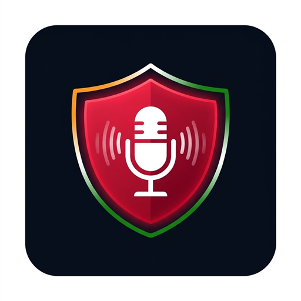

<div align="center">



# 🛡️ Awaaz Suraksha — आवाज़ सुरक्षा

**Voice-First Emergency Safety App for Women in India**

[](https://github.com/alwayspositivevibes/Awaaz-Suraksha-App/actions)


> Built for the **Wispr Flow × Scaler AI Voice Hackathon** by **Team CTRL ALT ELITE**

[📥 Download APK](#-download-apk) • [✨ Features](#-features) • [🔒 Security](#-security) • [📱 Triggers](#-sos-triggers)

</div>

---

## 📥 Download APK

Download the latest APK from **[GitHub Releases](https://github.com/alwayspositivevibes/Awaaz-Suraksha-App/releases)**.

Install on Android: `Settings → Install unknown apps → Allow`

---

## 🎯 Problem We Solve

Every 16 minutes, a woman is harassed in India. Existing SOS apps require manual taps — useless in a real emergency. **Awaaz Suraksha** activates with just your voice or a shake, even when your phone is in your pocket.

---

## ✨ Features

### 🗣️ Voice SOS (App Open)
- Says **"Help me now"** or **"Bachao"** — triggers SOS instantly
- Listens while Awaaz Suraksha is open; stops listening when the app is backgrounded
- Uses an offline Indian-English Vosk model, so Android speech-service tones are not used
- Hindi wake words may be less reliable than English; the model is about 38 MB
- Voice cancel: Say **"I'm safe"** to deactivate
- Model: [Vosk small Indian-English 0.4](https://alphacephei.com/vosk/models), Apache-2.0

### 📳 Background Shake Detection
- Shake the phone 3× within 1.5 seconds to trigger SOS, including while the screen is locked
- Raises an immediate SOS notification; open the app to continue contact alerts
- Continues after dismissing the app from Recents, but not after Android force-stop or device reboot

### 🚨 Multi-Trigger SOS
| Trigger | How |
|---------|-----|
| 🗣️ Voice | Say "Help me now" / "Bachao" |
| 👆 Tap | Tap the big red SOS button |
| 📳 Shake | Shake phone 3× within 1.5 seconds |
| 🤫 Silent | Hold the shield logo 3 seconds (zero sound) |

### 📍 GPS + WhatsApp Alert
- Captures GPS in 5–8s (high accuracy first, falls back to network)
- Sends Google Maps link to ALL trusted contacts via WhatsApp
- Alert message includes coordinates, timestamp, emergency numbers
- Fallback: direct call buttons if WhatsApp fails

### 🎙️ Audio Evidence Vault
- Auto-starts recording on SOS dispatch
- Saves as timestamped `.m4a` to private app storage
- 128kbps AAC — clear voice quality
- Shows live recording duration on SOS screen

### 👥 Trusted Contacts (up to 5)
- Indian phone validation (+91, 10-digit)
- Priority ordering (1 → 5)
- Edit/delete with one tap

### 📞 Fake Call Screen
- Pretend you're on a call to escape situations
- Choose caller: Maa / Dad / Didi / Bhai / 112 Control Room
- 0s / 5s / 10s / 30s delay
- Live call timer display

### 🏥 Emergency Helplines
- One-tap dial: **112** (Emergency) · **181** (Women) · **100** (Police) · **108** (Ambulance)

### 🔇 Silent SOS Mode
- Zero audio output — camera-off stealth mode
- Heavy vibration siren (triple haptic pulses)
- No TTS announcements

---

## 🔒 Security

| Feature | Status |
|---------|--------|
| Root detection | ✅ Warns user |
| Screenshot prevention | ✅ FLAG_SECURE via System |
| Local-only storage | ✅ No cloud, no servers |
| Input sanitization | ✅ Phone number validation |
| No analytics/tracking | ✅ Zero data collection |
| Offline-first | ✅ Works with no internet |

---

## 🏗️ Architecture

```
lib/main.dart (single-file Flutter app)
├── _SosBackgroundHandler     — Background shake detection via flutter_foreground_task
├── StorageService            — SharedPreferences (contacts, settings)
├── TtsService                — flutter_tts (en-IN, rate 0.52)
├── LocationService           — geolocator (high-acc + network fallback)
├── RecordingService          — record (AAC 128kbps)
├── WhatsAppService           — url_launcher (wa.me deep link)
├── SecurityService           — Root detection
├── HomeScreen                — Main UI + shake/voice guard
├── SosActiveScreen           — Active SOS countdown + dispatch
└── FakeCallScreen            — Fake call UI
```

---

## 📦 Stack

| Layer | Technology |
|-------|-----------|
| Framework | Flutter 3.27.1 |
| Language | Dart 3.3+ |
| Background | flutter_foreground_task 8.11 |
| Voice | speech_to_text 6.6.2 |
| TTS | flutter_tts 4.0.2 |
| GPS | geolocator 13.0.2 |
| Audio | record 6.0.0 |
| Sensors | sensors_plus 5.0.1 |
| Storage | shared_preferences 2.3.3 |
| Permissions | permission_handler 11.3.1 |
| Build | GitHub Actions + Flutter 3.27.1 + Java 17 |

---

## 🏃 Build Locally

```bash
flutter pub get
flutter build apk --debug --target-platform android-arm64
# APK at: build/app/outputs/flutter-apk/app-debug.apk
```

---

## 🏆 Hackathon

Built for the **Wispr Flow × Scaler AI Voice Hackathon**

**Team CTRL ALT ELITE**

> *Made with ❤️ in India*

---

<div align="center">
<sub>Offline-ready · Local storage only · No tracking · No cloud · Open source</sub>
</div>